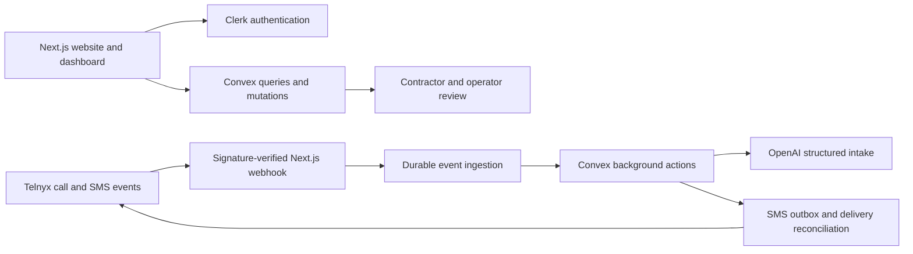

# RoofReply

A full-stack application for residential roofing contractors: a missed call can start an SMS conversation, collect roofing details, and hand the inquiry to a contractor for review.

This repository is a sanitized portfolio snapshot of the application. It includes the website, authenticated dashboard, backend, integration boundaries, and automated tests. Examples use fictional data. This source snapshot does not establish customer results or production readiness.

## What to explore

- **Durable webhook processing:** signed Telnyx events are persisted before acknowledgment, deduplicated, and processed asynchronously.
- **AI-assisted intake:** structured OpenAI responses collect roofing details; failures and unsupported requests route to contractor review.
- **Delivery recovery:** an outbox, delivery receipts, bounded retries, and explicit uncertain states reduce unsafe duplicate sends.
- **Tenant boundaries:** Clerk sessions authenticate Convex queries, with account-scoped authorization and restricted operator actions.
- **SMS consent:** STOP, START, HELP, account consent, and provider verification are part of the delivery flow.
- **Product experience:** responsive onboarding, lead conversations, operator views, a recovery assessment, and downloadable PDF tools.
- **Shared workspaces:** brand copy, roofing conversation policy, and social publishing contracts have separate source ownership.

## Architecture



| Area | Responsibility |
| --- | --- |
| `app/`, `components/` | Website, dashboard, onboarding, and API ingress |
| `convex/` | Schema, authorization, durable events, outbox, receipts, and scheduled recovery |
| `lib/` | Provider clients, intake/compliance rules, calculations, analytics policy, PDF generation, and unit tests |
| `tests/` | Backend integration tests with synthetic records and mocked provider calls |
| `packages/brand/` | Shared website and marketing copy |
| `agents/roofing-lead/src/` | Dependency-free roofing conversation policy |
| `agents/social/src/` | Shared social content, publishing contracts, and tests |

Start with [webhook ingress](app/api/telnyx/webhook/route.ts), [background processing](convex/automationActions.ts), [AI intake](lib/ai.ts), [authorization](convex/authHelpers.util.ts), and [backend integration tests](tests/pilot.test.ts).

## Run locally

Use Node.js 24 and npm. Install all workspaces from this repository root:

```sh
npm ci
cp .env.example .env.local
```

Supply credentials for your own Clerk, Convex, Telnyx, OpenAI, and PostHog accounts. No shared service credentials or production configuration are included. Set the Convex JWT template in Clerk to `convex`, and configure the matching issuer in Convex. Next.js and Convex must share `ROOFREPLY_SERVICE_SECRET`; server/action variables belong on the host executing them.

```sh
npx convex dev
# In another terminal:
npm run dev
```

The dashboard requires authentication and a configured backend. SMS and AI features require configured providers and customer-specific acceptance. Telnyx senders are assigned per account; there is no global sender number. Use your own consenting test recipients and provider-approved messaging configuration.

Social account IDs and deployment origins are placeholders and social generation is disabled in this snapshot. Contact addresses, scheduling links, and phone numbers shown by the demo page are placeholders. Private agent studios, local workers, deployment runbooks, historical records, contact lists, and the original commit history are excluded.

## Verify

The test suites run locally without contacting live SMS or AI providers:

```sh
npm run lint
npm test
npm run test:backend
npm run typecheck:workspaces
```

Build after configuring your own environment:

```sh
npm run build
```

Regenerate the included public PDF and blank tracking sheet with `npm run rescue-kit:assets`. They contain instructions and fictional examples, not customer records.

## Publication and security

This snapshot starts with a fresh Git history and does not contain a production deployment connection. Use [SECURITY.md](SECURITY.md) for reporting vulnerabilities. Dependency and font notices are retained in [THIRD_PARTY.md](THIRD_PARTY.md) and `lib/pdf/fonts/`.

The application source is published for inspection. No additional reuse license is granted here; third-party assets retain their own licenses.
